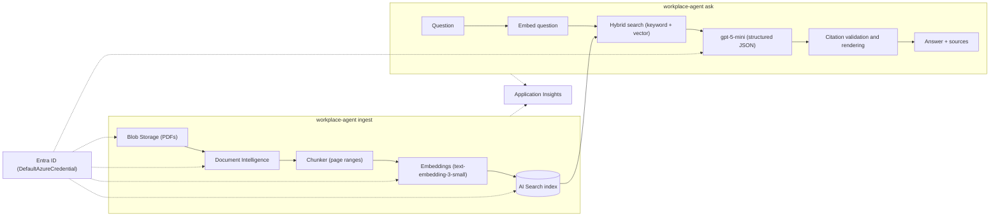

# workplace-agent

A command-line assistant that ingests company policy PDFs into Azure AI Search and answers employee questions with cited, grounded answers. It is a portfolio project built to show an end-to-end Azure AI stack: keyless auth, idempotent ingestion, hybrid retrieval, deterministic answer validation, infrastructure as code, and a measured evaluation.

**Status:** Work in progress. Spec 1 (document ingestion + grounded Q&A CLI) is complete and deployed on Azure; the agent, Microsoft Graph and Teams features are on the roadmap.

Author: Dona Shterjova

## Tech

Python 3.12, uv, Typer, Azure AI Document Intelligence, Azure OpenAI (gpt-5-mini, text-embedding-3-small) via Microsoft Foundry (AIServices), Azure AI Search (hybrid), Azure Blob Storage, Key Vault, Application Insights / OpenTelemetry, Bicep, GitHub Actions + Azure DevOps pipeline, pytest, ruff.

## Architecture



## Quickstart

Prerequisites: Azure CLI, `uv`, and an Azure subscription. Full steps in [docs/setup.md](docs/setup.md).

```bash
uv sync
scripts/deploy.sh                                   # what-if, confirm, deploy Bicep, write .env
scripts/upload-samples.sh                           # uploads samples/documents to Blob Storage
uv run workplace-agent ingest                       # parse, chunk, embed, index
uv run workplace-agent ask "What is the daily meal allowance?"
uv run workplace-agent eval                         # runs the 20-question set
```

The 12 sample PDFs (fictional company "Northwind Workplace") are described in [samples/README.md](samples/README.md).

## Example output

```text
$ uv run workplace-agent ask "What is the daily meal allowance?"
The daily meal allowance for domestic trips is EUR 45. [1] The daily meal allowance for international trips is EUR 60. [1]

Sources:
[1] Travel and Expenses Policy, p. 1

$ uv run workplace-agent ask "What is the CEO's favourite food?"
I couldn't find this in the company documents.
```

## Evaluation

20 questions (17 answerable, 3 that must be refused) run against the deployed environment on 2026-11-16. Full per-question output: [docs/eval-results.md](docs/eval-results.md).

| Metric | Result | Target |
|---|---|---|
| Hit rate | 94.1% (16/17) | at least 90% |
| Citation presence | 94.1% | at least 90% |
| p95 response time | 3.5s | at most 8.0s |
| p50 response time | 2.7s | informational |

One answerable question missed: "What is the minimum length for a password?". The top-5 hybrid results did not include the IT Security Policy because the sample passages share near-identical boilerplate, so keyword and vector signals were weak. The model correctly refused instead of guessing. Nothing was tuned to hide this. Twenty questions only catches large regressions; it is a smoke test, not a benchmark.

## Design decisions

- **Keyless Entra ID auth everywhere.** `DefaultAzureCredential` for Blob, Document Intelligence, Azure OpenAI and AI Search, including the free tier (verified). RBAC is assigned in Bicep; no keys in code or `.env`.
- **Crash-safe re-ingest.** Chunk 0 is written last and acts as the commit marker, and state lives in the index itself, so a crash between steps is detected and redone. IDs are deterministic and writes use `merge_or_upload`; leftover chunks of shortened or removed documents are cleaned up.
- **Change detection by content hash** that includes the pipeline version, so a chunker or model change re-processes documents.
- **Deterministic citation validation.** The model returns structured JSON; code drops invalid citations and absence sentences with no cite, dedupes sources, renumbers, and enforces the 150-word cap. Rendering is never left to the model.
- **Page ranges.** Chunks carry start and end pages (tables spanning pages keep their header), so citations read like "p. 3-4".
- **Error classification.** Failures are labelled password-protected, unreadable, or temporary; transient 429/5xx are retried, and one bad document is logged and skipped without aborting the batch. The CLI exits non-zero on failures.
- **Model change handled in config.** gpt-4o-mini was rejected as deprecated, so the chat model is now gpt-5-mini via Bicep parameters (`chatModelName`, `chatModelVersion`), with `reasoning_effort` minimal.

## Testing and CI

- Unit tests use fakes behind Protocols (`tests/fakes.py`); no Azure is called. Current result: `131 passed, 5 deselected` from `uv run pytest -m "not integration"`.
- Live tests in `tests/integration/` are marked `integration` and skipped without the env vars.
- New tests were validated RED first (they fail without the change they cover).
- GitHub Actions ([.github/workflows/ci.yml](.github/workflows/ci.yml)) and [azure-pipelines.yml](azure-pipelines.yml) run ruff, pytest and `az bicep build`.

## Cost and teardown

Everything is reproducible from Bicep in [infra/](infra/). AI Search uses the free tier; Azure OpenAI, Document Intelligence and Blob Storage are pay per use, so the full sample run (ingest + eval) costs a small amount of credit. Resources are in one resource group.

```bash
scripts/teardown.sh   # asks you to type the resource group name; deletes it and purges soft-deleted accounts
```

The Azure for Students credit expires on **2026-11-27**. Tear down before then, and whenever the project is idle.

## Roadmap (planned, not built)

- API on Azure Container Apps
- Microsoft Foundry agent
- Entra sign-in plus Microsoft Graph mail and calendar, with user approval
- SharePoint ingestion with permission filtering
- QLoRA-fine-tuned intent router
- Microsoft Teams integration

## Project structure

```text
src/workplace_agent/
  cli.py            Typer commands: ingest, ask, eval
  config.py         pydantic-settings
  azure_clients.py  credential and client factories
  ports.py          Protocols for fakes
  errors.py         failure classification
  telemetry.py      OpenTelemetry / App Insights
  ingestion/        blobs, parser, chunker, embedder, index, pipeline
  retrieval/        search, prompt, chat, answer, evaluation
tests/              unit/ (fakes), integration/ (live, marked)
infra/              main.bicep + modules (ai, search, storage, keyvault, monitoring, rbac)
scripts/            deploy.sh, env.sh, upload-samples.sh, teardown.sh, make_samples.py
samples/            sample PDFs and fixtures
eval/               evaluation question set
docs/               setup.md, eval-results.md
context/            product and spec documents
```

## Built with spec-driven development (AWOS)

Requirements and design were written before code: [product definition](context/product/product-definition.md), [architecture](context/product/architecture.md), and [spec 001](context/spec/001-document-ingestion-and-qa-cli/functional-spec.md) ([technical considerations](context/spec/001-document-ingestion-and-qa-cli/technical-considerations.md), [tasks](context/spec/001-document-ingestion-and-qa-cli/tasks.md)).
